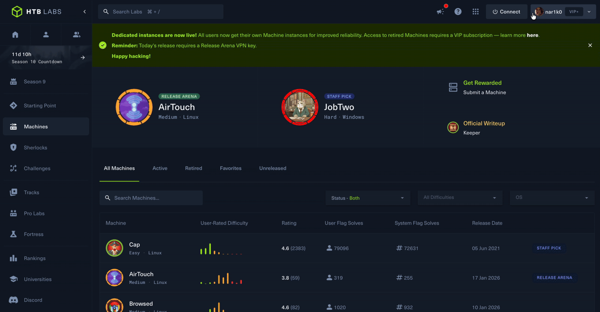
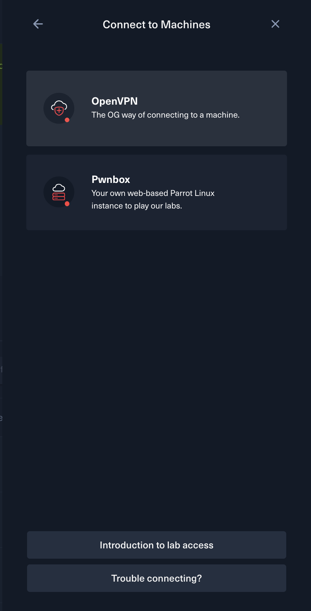
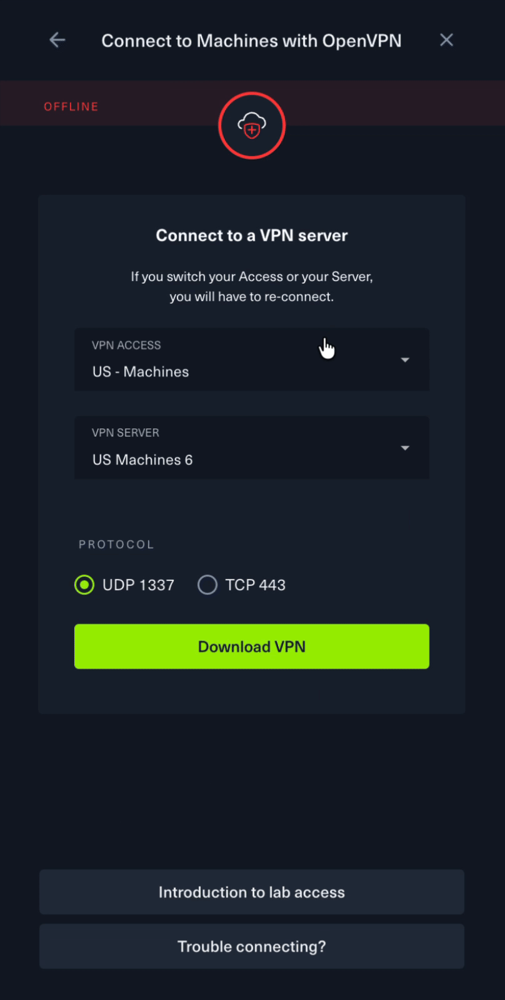
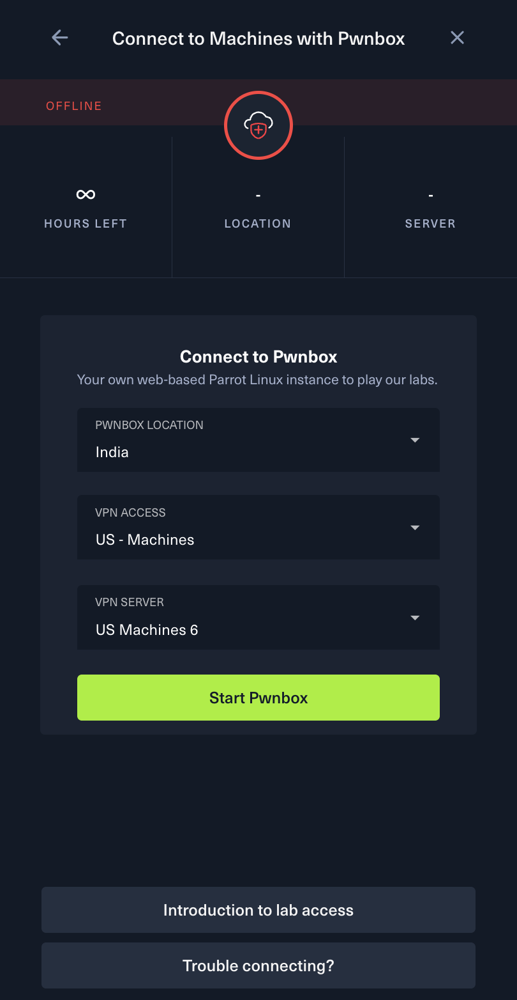
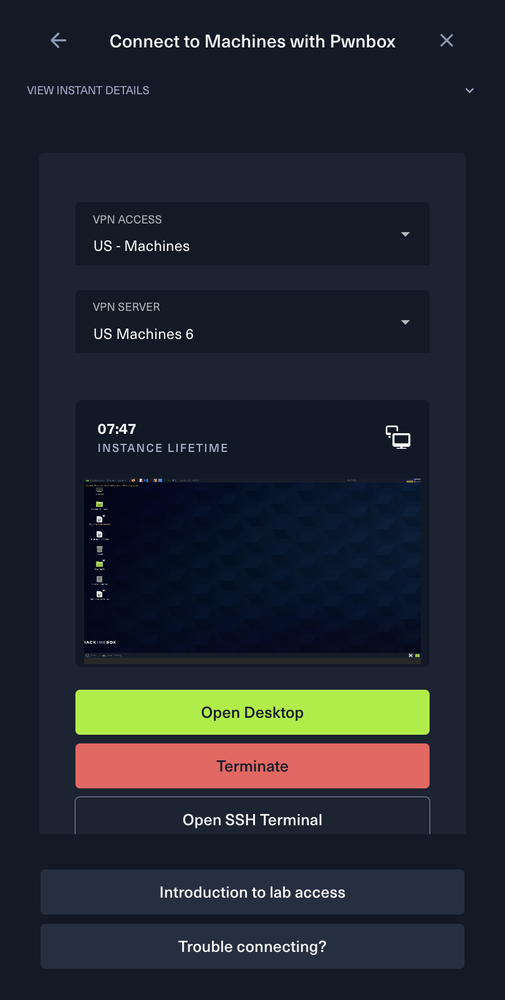
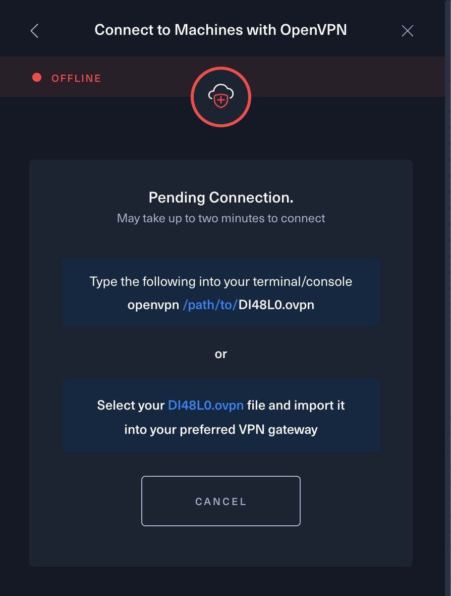
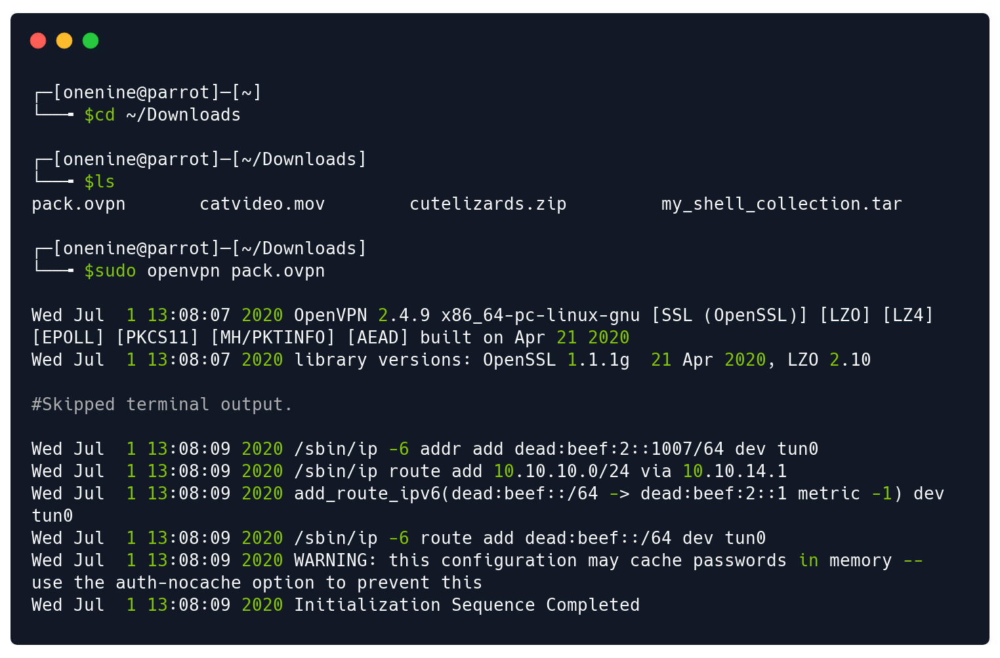

> 来源：[Hack The Box Help Center](https://help.hackthebox.com/en/articles/5185687-introduction-to-lab-access) · 中文译文，插图取自原文 · 翻译日期：2026-09-13
>
> 本文介绍如何连接 VPN 并访问 HTB 实验室里的靶机。

在 Hack The Box，我们使用 **OpenVPN** 连接，在你的设备和我们的实验室、靶机之间建立链路。你可能用过面向个人的各种"个人 VPN"服务，但我们这个 VPN 的用途完全不同。

**个人 VPN** 是这样一类服务：把设备的互联网连接加密，再经由一台用户自选地点的服务器转发。它可以用来保护隐私，也可以用来绕过网络审查。个人用户常用它防止上网行为被监控，或者隐藏自己的真实位置。

而**公司/组织提供的 VPN** 通常是为了让员工从外面远程访问公司内网。这类 VPN 在用户设备和公司网络之间建立一条安全连接，你访问内部资源时，就像人坐在公司里插着网线一样。

我们提供的各类 **VPN 配置文件**，作用是让你通过互联网接入我们的**内部实验网络**。这些用来自动配置 OpenVPN 客户端的配置文件，叫 **VPN 包**（VPN pack）或 **VPN 文件**（VPN file）。

有了它，你会被放进和漏洞靶机相同的 IP 子网，从而能够连到它们（然后攻击它们）。

你需要准备：

- 教学 VPN 包（Tutorial VPN packs）——原页面为图文卡片链接
- 免费 VPN 包（Free VPN packs）——原页面为图文卡片链接

如果你购买了 **VIP+ 订阅**，还能看到 **VIP+** 的 VPN 包。它们和上面列出的免费包长得一样，只是把"Free"换成了"**VIP+**"。

> 连接 VPN 并不强制要求 Linux 环境，但我们强烈建议使用 Linux 虚拟机。如果你还没搭好 Linux 虚拟机，原文提供了一个专门的入门文章链接。

## VPN 设置与控制台配置

要调整、配置或下载连接参数，用控制台（dashboard）任一视图里都有的全局交互控件：

### OpenVPN 分配步骤

如果你选择使用单独的 `.ovpn` 配置文件，请依次完成以下设置：

## Pwnbox 分配步骤

Pwnbox 的配置项和 OpenVPN 一致，也是选层级（tier）、地区（region）、协议（protocol）。但要多做下面几步操作：

## 启动 OpenVPN

点击 **Download** 按钮后，`.ovpn` 文件默认会下载到你 Linux 发行版的 Downloads（下载）目录。接下来就拿这个文件作为配置，启动 OpenVPN。

在 Linux 终端里建立隧道，严格按图中步骤操作：

遇到问题的话，去帮助中心的 [连接故障排除](https://help.hackthebox.com/en/articles/5185536-connection-troubleshooting) 文章开始排障。

## VPN 控制菜单详解

下面逐一解释所有 VPN 控制菜单：

### Access（实验室选择）

在 **Access** 菜单里，可以从 Machines（靶机）专区所有可用的实验室中选择，包括免费服务器和 VIP+ 服务器——VIP+ 现在新增了呼声很高的澳大利亚（AU）VIP+、新加坡（SG）免费和 SG VIP+ 服务器。

最佳实践：**选离你最近的实验室**，同时考虑你账号的 VIP+ 订阅状态。

告诉大家一个好消息：自 2026 年 1 月 15 日起，免费用户和现有 VIP 用户在打 Machines 时都会拿到**专属实例**。这意味着性能稳定，更重要的是——没人会和你抢同一台靶机！详情见 HTB 官方博客。

### Server（服务器选择）

在 **Server** 菜单里选择你要连的具体 VPN 服务器。选好之后就能直接下载 `.ovpn` 连接包，开始对 Machines 动手了。

我们用"手动选服务器"取代了"随机把用户分到人最少的服务器"，因为有不少人提需求：希望多个队友连同一台 VPN 服务器、打同一些靶机，互相较量。希望这个改动能进一步提升团队协作，让你和你的团队、组织的学习进度更上一层楼！

### Download（下载）

**Server** 选择菜单右边就是 **Download** 按钮，用来下载刚生成的 `.ovpn` 包。点击后开始下载 `.ovpn` 文件，拿它启动你 Linux 系统上的 OpenVPN 进程，就能连上我们实验室里的 Machines 了。

### Regenerate（重新生成）

如果 `.ovpn` 文件因错误生成异常，可以在所选实验室的各台服务器之间来回切换，重新生成文件。新的 `.ovpn` 文件生成后，直接下载到你的系统即可。

如果重新生成之后 `.ovpn` 文件仍然无效，随时联系 HTB 支持团队。

---

**相关文章**

- [Introduction to Pwnbox（Pwnbox 入门）](https://help.hackthebox.com/en/articles/5185685-introduction-to-pwnbox)
- [Introduction to Starting Point（Starting Point 入门）](https://help.hackthebox.com/en/articles/5185636-introduction-to-starting-point)
- [Understanding the Hack The Box VPN（理解 HTB 的 VPN）](https://help.hackthebox.com/en/articles/5185711-understanding-the-hack-the-box-vpn)
- [Connecting to Academy VPN（连接 Academy VPN）](https://help.hackthebox.com/en/articles/5185688-connecting-to-academy-vpn)

---

**术语说明**

- **Machines**：HTB 主站的靶机专区；**Pwnbox**：HTB 提供的在线版 Linux 攻击机（浏览器里直接用，不用自己装虚拟机）。
- **VPN pack / `.ovpn` 文件**：OpenVPN 的配置文件，写好了服务器地址、证书等信息。`sudo openvpn xxx.ovpn` 就是拿它启动连接。
- **AU / SG**：澳大利亚 / 新加坡服务器节点。
- 服务器协议怎么选：优先 UDP（1337 端口），连不上或频繁掉线再换 TCP（443 端口）。
